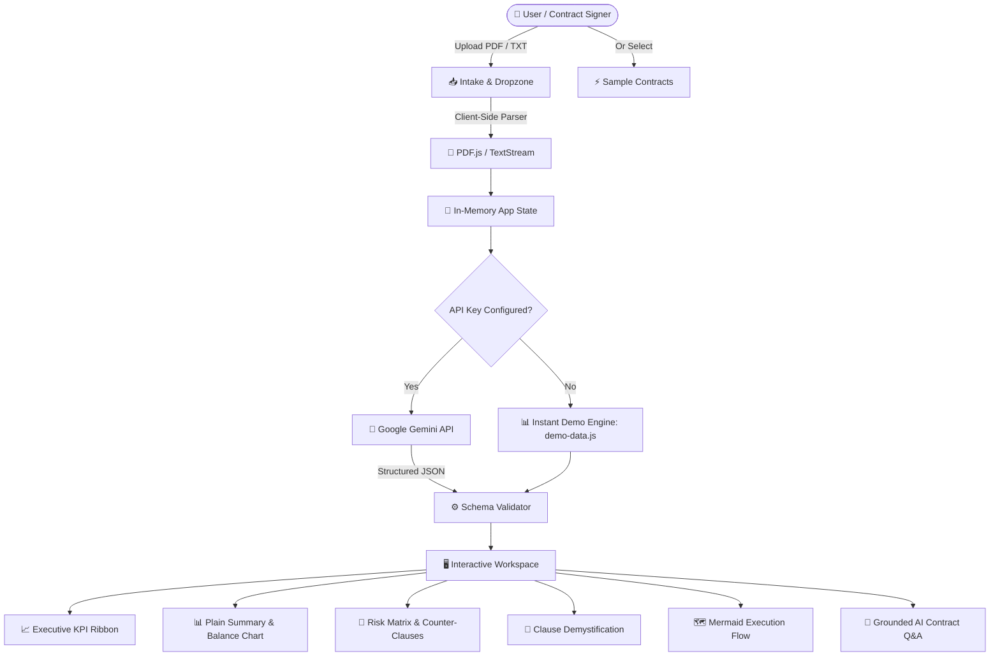

<div align="center">

# ⚖️ Legal Demystifier

### AI-Powered Contract Demystification, Risk Intelligence & Clause Translation Engine

[](LICENSE)
[](https://ai.google.dev/)
[](package.json)
[](SECURITY.md)
[](https://nodejs.org/)
[](CONTRIBUTING.md)

<p align="center">
  <b>Transform dense legalese into plain, everyday language. Detect predatory clauses, analyze obligation balance, and negotiate counter-clauses with confidence.</b>
</p>

[Quickstart](#-quickstart) • [Key Features](#-key-features) • [Architecture](#-architecture) • [Sample Contracts](#-sample-contracts) • [Privacy & Security](#-privacy--security) • [Contributing](#-contributing)

</div>

---

## 🎯 The Problem & Our Solution

Legal contracts govern our lives—from renting an apartment, signing an employment offer, starting freelance work, to agreeing to software terms. Yet they are written in impenetrable, archaic jargon designed by lawyers, for lawyers.

This linguistic barrier creates:
- **Uninformed Signatures**: People sign agreements without understanding critical commitments.
- **Hidden Predatory Traps**: One-sided clauses (unrestricted entry, perpetual non-competes, unlimited liability) bury dangerous liabilities in boilerplate text.
- **Asymmetric Power Dynamics**: Consumers and small businesses cannot afford thousands of dollars in attorney review fees for routine contracts.

**Legal Demystifier** levels the playing field using Google's state-of-the-art **Gemini AI**. It extracts key clauses, translates jargon into simple conversational English, quantifies agreement fairness, flags severe risks, and provides **ready-to-send counter-clauses** to empower you during negotiations.

---

## ✨ Key Features

| Feature | Description |
| :--- | :--- |
| **🧠 Multi-Model Gemini Engine** | Seamless support for **Gemini 2.0 Flash**, **Gemini 1.5 Flash**, and **Gemini 1.5 Pro** for blazing-fast or deep legal analysis. |
| **🚨 Risk Matrix & Counter-Clauses** | Automatically filters clauses into High, Medium, and Low risk with **1-click copyable counter-clauses** for immediate negotiation. |
| **⚖️ Balance Score & Fairness Chart** | Interactive Chart.js doughnut visualization illustrating the percentage distribution of obligations between parties. |
| **👥 Persona-Tailored Intelligence** | Dynamic advice tailored to **Students**, **Freelancers**, **Business Owners**, and **Legal Counsel**. |
| **🌐 Native Multilingual Support** | Direct native analysis in 10 languages: English, Spanish, French, German, Italian, Portuguese, Hindi, Bengali, Japanese, and Arabic. |
| **💬 "Ask Demystifier" AI Chat** | Ask natural-language questions grounded specifically in your uploaded document's text. |
| **🗺️ Decision Roadmap** | Automated Mermaid.js workflow diagram depicting contract review and decision-making logic. |
| **⚡ Instant Offline Demo Mode** | Explore full dashboard features immediately using pre-analyzed sample contracts—no API key required upfront! |
| **🔒 100% Client-Side Privacy** | Zero backend intermediary. Document parsing (`PDF.js`) and API calls happen directly in your browser over HTTPS. |
| **📥 Multi-Format Export** | Download a complete Markdown audit report (`.md`) or trigger a print-ready PDF summary with one click. |
| **🎨 Dark & Light Modern UI** | Engineered with pure vanilla CSS, glassmorphism aesthetics, fluid typography, and accessible contrast. |

---

## 🏛️ Architecture



Read the full technical breakdown in [docs/ARCHITECTURE.md](docs/ARCHITECTURE.md).

---

## 🚀 Quickstart

### Prerequisites
- Modern web browser (Chrome, Firefox, Safari, Edge)
- (Optional for local dev) [Node.js](https://nodejs.org/) v18+ or Python 3.x

### 1. Clone the Repository
```bash
git clone https://github.com/pgatdesk/GenAIExchangeHumanAIzed.git
cd GenAIExchangeHumanAIzed
```

### 2. Launch Local Server
Legal Demystifier requires **zero npm packages to install**! Start the built-in server:

```bash
# Using Node.js:
npm run dev

# Or using Python:
python -m http.server 3000
```

### 3. Open in Browser
Navigate to:
```
http://localhost:3000
```

---

## ⚙️ Configuration & API Key

Legal Demystifier works in two modes:

1. **Demo Mode (Default)**:
   - Click any sample contract (**Residential Lease**, **Mutual NDA**, or **Freelance Contract**) to immediately explore the entire intelligence suite without an API key.

2. **Live AI Mode**:
   - Click the **API Settings** badge in the top-right navigation bar.
   - Enter your free Gemini API key from [Google AI Studio](https://aistudio.google.com/app/apikey).
   - Your key is saved locally in your browser's private `localStorage` and sent directly to Google's official endpoints over HTTPS.

---

## 📁 Sample Contracts Included

To facilitate immediate testing and evaluation, three realistic, battle-tested contracts are included in the [`samples/`](samples/) folder:

| Sample Contract | Key Traps & Red Flags Detected |
| :--- | :--- |
| [`residential_lease_agreement.txt`](samples/residential_lease_agreement.txt) | Unilateral 15% rent hikes with 7-day notice, 24/7 unrestricted landlord entry, structural repair shifting, total deposit forfeiture. |
| [`mutual_non_disclosure_agreement.txt`](samples/mutual_non_disclosure_agreement.txt) | Hidden worldwide 24-month non-compete, perpetual confidentiality without sunset, $250k automatic liquidated damages penalty. |
| [`freelance_services_contract.txt`](samples/freelance_services_contract.txt) | Net-90 payment with 180-day 40% retention, unlimited revisions, work-for-hire pre-existing IP grab, unlimited personal liability. |

---

## 🔒 Privacy & Security

We believe legal documents demand the highest standard of confidentiality:
- **No Middleman Server**: There is no proxy or logging backend. Your document is parsed locally via Web Workers and sent straight from your browser to Google Gemini.
- **Ephemeral Processing**: Contract text is held in browser memory and discarded upon page reload.
- **Secure Key Storage**: API keys never leave your machine except when authenticating directly with Google's API.

For our vulnerability disclosure policy, see [SECURITY.md](SECURITY.md).

---

## 🛠️ Technology Stack

- **Core**: Vanilla HTML5, modern ES6+ JavaScript modules.
- **Styling**: Tailored Vanilla CSS design system with CSS custom properties, glassmorphism, and responsive grid layout.
- **AI Integration**: Google Gemini API (`gemini-2.0-flash`, `gemini-1.5-flash`, `gemini-1.5-pro`).
- **Data Visualization**: [Chart.js](https://www.chartjs.org/) for doughnut fairness metrics.
- **Flowchart Rendering**: [Mermaid.js](https://mermaid.js.org/) for decision lifecycles.
- **Document Parsing**: [PDF.js](https://mozilla.github.io/pdf.js/) for in-browser PDF extraction.

---

## 👥 Contributors & Authors

- **Priyansh Gautam** ([@pgatdesk](https://github.com/pgatdesk))
- **Komal**
- **Ritishaa Anand**
- **Bhukya Chenna Keshav**

---

## 🤝 Contributing

We welcome community contributions, bug reports, and suggestions! Please review [CONTRIBUTING.md](CONTRIBUTING.md) and [CODE_OF_CONDUCT.md](CODE_OF_CONDUCT.md) before submitting pull requests.

```bash
# Validate syntax before submitting PRs
npm test
```

---

## 📄 License

This project is open-source and licensed under the [MIT License](LICENSE).

---

<div align="center">
  <b>Built with ❤️ to make the law accessible, fair, and understandable to everyone.</b>
</div>
