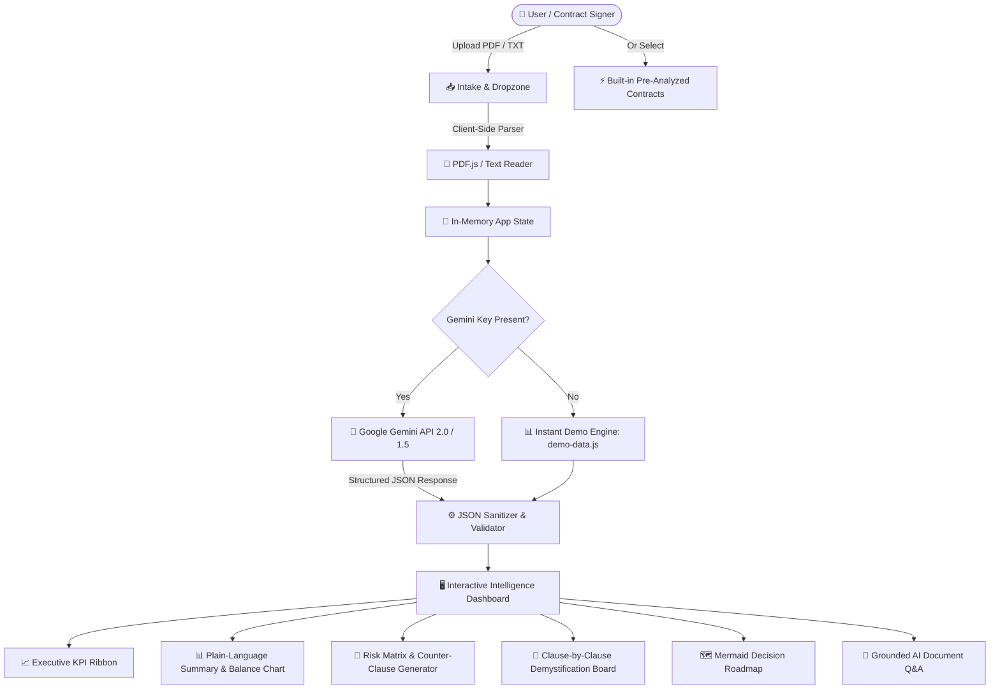

# Legal Demystifier: System Architecture & Technical Design

## 🏛️ High-Level System Architecture

Legal Demystifier is an AI-powered legal intelligence web application engineered to operate with zero server-side state, ensuring maximum client-side privacy, sub-second interactive speeds, and zero database dependencies.

---

## 🧩 Core Architectural Components

### 1. Client-Side Document Parsing Layer
- **`PDF.js`**: Parses binary PDF contracts directly within the browser runtime using web workers (`pdf.worker.min.js`), extracting page streams into continuous UTF-8 plain text without exposing file contents to external proxies.
- **Native File API**: Reads `.txt` files with zero overhead.

### 2. Multi-Model Google Gemini Integration
- **Direct HTTPS Endpoint**: Calls `https://generativelanguage.googleapis.com/v1beta/models/{model}:generateContent`.
- **Supported Engines**:
  - `gemini-2.0-flash`: Recommended default for rapid generation, 1M+ context window, and sharp instruction following.
  - `gemini-1.5-flash`: Fast, cost-efficient analysis.
  - `gemini-1.5-pro`: Deep analytical reasoning for high-stakes multi-party contracts.
- **Strict Structured Outputs**: Forces `responseMimeType: "application/json"` with schema adherence for predictable rendering across all dashboard panels.

### 3. Native Multilingual Pipeline
Unlike brittle translation architectures that translate English text via secondary translation APIs (which lose legal nuances), Legal Demystifier directly prompts Gemini in the target language (e.g., Hindi, Spanish, French, German, Japanese). Gemini directly generates natural, idiomatic legal explanations natively.

### 4. Zero-Dependency Local Dev Server
- `server.js`: Lightweight, native Node.js HTTP server mapping MIME types and handling single-page asset delivery without requiring external npm packages.

### 5. UI/UX Design System
- Built with pure Vanilla CSS, CSS Custom Properties (`[data-theme="dark"]` and `[data-theme="light"]`), CSS Grid, and responsive flexbox.
- Hardware-accelerated micro-animations, glassmorphism backdrops (`backdrop-filter: blur`), and accessible WCAG color contrast standards.
